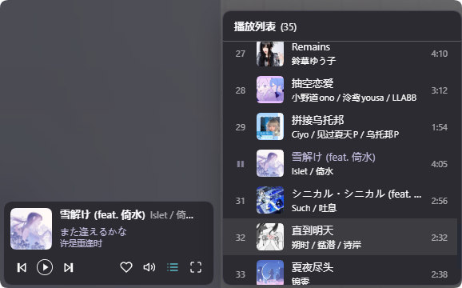

# DSH_Plugin

存储一些个人创建使用的插件（DSH · DeepSeek Harness）。



## 插件列表

| 目录 | 插件 | 说明 |
|---|---|---|
| [`ncm-sidecard/`](./ncm-sidecard) | 网易云音乐侧边栏卡片 | 把 ncm-player 关闭后的形态搬进侧边栏：歌名 / 歌手 / 双语歌词 / 播放控制 / 收藏 / 音量 / 播放列表；可选按封面取色的 Material 3 配色与自定义背景色 |
| [`dsh-plugin-organizer/`](./dsh-plugin-organizer) | 插件整理器 | 给插件页加「分类与方案」标签：插件按自定义分类分组、可整组开关；把一组插件存成「配置方案」，一键开启（独占模式还会关掉其余插件）或整体关闭 |

## 安装方式

每个插件目录都是独立的 DSH 插件包，互不依赖。通用流程：

```bash
git clone git@github.com:Mny-Akum/DSH_Plugin.git
cd DSH_Plugin/<插件目录>
pnpm install                 # 插件目录若声明了宿主依赖，必须在这里装一份
dsh plugin add link:$(pwd)   # 或在 DSH 里用「Add plugin」填入该绝对路径
```

装好后**彻底退出 DSH 再启动**（关窗口不算），再刷新页面。

> 为什么要在插件目录里 `pnpm install`：DSH 宿主从插件的真实路径解析依赖，
> `link:` 安装不会替插件装依赖，缺依赖时该行会「组件启用失败」。

各插件的依赖、配置、界面与提示词见其目录下的 README。
