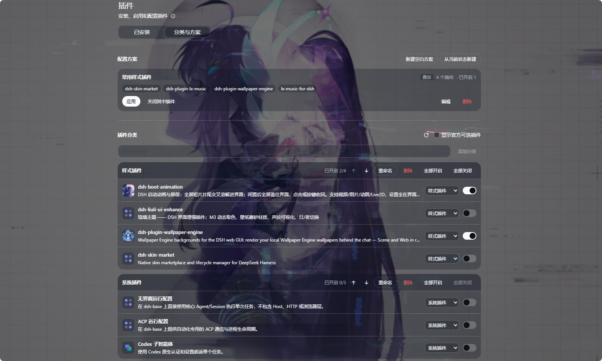

# 插件整理器 · dsh-plugin-organizer

给 DSH 的插件页加一个 **「分类与方案」** 标签：插件可以按自己的想法分类，需要一次性开关的一组插件可以存成「配置方案」，点一下就整套切换。



截图里：上面是「配置方案」（一个叫「常用样式插件」的方案，叠加模式，4 个插件、已开启 1 个），下面是「插件分类」（样式插件 / 系统插件两组，每组都能整组开关）。

## 功能

- **自由分类**：新建、重命名、上移下移、删除分类；每个插件行右侧的下拉框指定它属于哪个分类；删除分类时里面的插件自动回到「未分类」。
- **整组开关**：每个分类头部有「全部开启 / 全部关闭」，显示该分类「已开启 2/4」。
- **配置方案**：
  - **从当前状态新建** —— 把此刻开着的插件直接存成一个方案；也可以**新建空白方案**再逐个勾选。
  - **应用** —— 开启方案里的插件；开启「独占模式」时还会关闭不在方案里的其他插件，适合整套切换。
  - **关闭其中插件** —— 一次关掉方案里的所有插件。
  - 方案里显示「4 个插件 · 已开启 1」，能直接看出当前状态和方案的差距。
- **单个开关**：每行右侧的开关直接改插件启停，走的是 DSH 自带 Plugin Manager 的同一套接口，和插件页原本的开关完全等价。
- **未安装的插件会被识别**：方案里引用了但已经卸载的插件会标「未安装」，应用时跳过并提示，不会报错卡住。
- **不碰关键项**：基础 bundle（`@deepseek-ai/dsh-base`、`@deepseek-ai/dsh-web-app`）和本插件自身不会出现在列表里，避免把自己关掉。
- **官方可选插件默认隐藏**：勾选「显示官方可选插件」才会列出来，平时的列表更清爽。
- **自动同步**：从插件页其它地方改动了开关，本页会自动重新读取，不用手动刷新。

## 依赖

| 依赖 | 说明 |
|---|---|
| DSH 桌面版 / Web | 需要具备 `plugins.tab` 客户端槽位（由 `@deepseek-ai/dsh-client-ui-plugin-manager` 提供）与 `settings` 服务（`@deepseek-ai/dsh-settings` + `@deepseek-ai/dsh-config-editor`）。这三者都在默认的 `dsh-base` / `dsh-web-app` 里，正常安装即有。开发验证版本：**0.2.2-rc.1** |
| `@deepseek-ai/schemastery` `~3.19.0` | host 半边用来声明分类/方案的数据结构（Config），已写在 `peerDependencies`，**由 DSH 运行时直接提供，插件目录不需要 `pnpm install`** |

> 如果你的 DSH 版本较老、加载本插件时报 `Cannot find package '@deepseek-ai/schemastery'`，
> 在插件目录里执行一次 `pnpm install` 再重启 DSH 即可（这也是仓库里其它插件的通用做法）。

插件本身**没有任何 npm 运行时依赖**，纯 ESM 原生 JS，没有构建步骤。

## 安装

### 方式一：克隆 + 本地路径（推荐）

```bash
git clone git@github.com:Mny-Akum/DSH_Plugin.git
cd DSH_Plugin/dsh-plugin-organizer
dsh plugin add link:/绝对路径/DSH_Plugin/dsh-plugin-organizer
```

`dsh plugin add` 也可以直接给绝对路径：`dsh plugin add /绝对路径/DSH_Plugin/dsh-plugin-organizer`。

### 方式二：pnpm 的 git 子目录选择器

```bash
dsh plugin add "github:Mny-Akum/DSH_Plugin#path:/dsh-plugin-organizer"
```

取决于你的 pnpm 版本是否支持 `#path:` 选择器；不支持时请用方式一。

### 方式三：在 DSH 界面里装

侧边栏 **插件 → Add plugin**，把上面那个绝对路径填进去即可。

### 安装后

1. 打开侧边栏 **插件**，在「已安装」右边会多出 **「分类与方案」** 标签；
2. 如果没看到标签，**彻底退出 DSH 再启动**（关窗口不算，需结束进程）后刷新页面。

## 使用

### 插件分类

1. 「新分类名称」输入框里写名字 →「添加分类」；
2. 每个插件行右侧的下拉框选分类；
3. 分类头部的 `↑ ↓` 调顺序，「重命名」改名，「删除」删除（两段式：第一次点变成「确认删除？」，再点才删）。

### 配置方案

1. 「从当前状态新建」或「新建空白方案」；
2. 编辑页里勾选「应用此方案时需要开启的插件」，可点「填入当前已启用的插件」一键选中现在开着的；
3. 需要整套切换就勾上「独占模式：应用时关闭不在此方案中的其他插件」；
4. 「保存」后，卡片上点「应用」即可。

切换过程中顶部会显示进度；结束后会告诉你切换了几个、哪些改动需要重启 DSH 才生效、哪些失败了。

## 数据存放

分类与方案就存在当前 profile 的 `cordis.patch.yml` 里 `plugin-organizer` 这一行的 `config` 下，**可以直接手动编辑**：

```yaml
- id: plugin-organizer
  config:
    categories:
      - { id: cat-style, name: 样式插件 }
      - { id: cat-system, name: 系统插件 }
    assignments:
      dsh-skin-market: cat-style
      dsh-plugin-wallpaper-engine: cat-style
    presets:
      - id: preset-daily
        name: 常用样式插件
        exclusive: false
        bundles: [dsh-skin-market, dsh-plugin-lx-music, dsh-plugin-wallpaper-engine, lx-music-for-dsh]
```

- 这一行的字段全部是 volatile 的：在界面里改**立即生效**，不用重启；
- 插件开关本身不写在这里，而是由 DSH 的 Plugin Manager 写进同一个 patch 文件（以 `disabled: true` 的形式）。

## 排查

| 现象 | 处理 |
|---|---|
| 插件页没有「分类与方案」标签 | ① 该 bundle 是否已启用；② 彻底重启 DSH 后刷新页面；③ 控制台有没有 `plugin-organizer` 相关报错 |
| 标签在，但提示「未读取到插件整理器的配置」 | `plugin-organizer` 这一行没加载成功：检查它是否被别的 patch 覆盖或禁用，必要时重启 |
| 组件启用失败 / `Cannot find package '@deepseek-ai/schemastery'` | 在插件目录执行 `pnpm install` 后重启 DSH |
| 开关点击无反应、显示「不允许」 | 该插件是管理组件或基础 bundle，DSH 本身不允许通过配置关掉它 |
| 应用方案后提示需要重启 | 当前 profile 没开 HMR（`dsh-hmr`），这类改动在重启后生效，属正常现象 |

## 给 DSH 的安装提示词

把下面这段直接粘给 DSH 的 Agent，它会按步骤装好并验证：

```text
请帮我把 GitHub 仓库 git@github.com:Mny-Akum/DSH_Plugin.git 里的 dsh-plugin-organizer 插件安装到当前 profile：

1. 克隆仓库到本地任意目录（记作 <repo>）。
2. 用插件管理把它装上：plugin_manager install_bundle，target 填 <repo>/dsh-plugin-organizer 的绝对路径，并确认该 bundle 已启用、application 为 applied。
3. 如果返回 Cannot find package '@deepseek-ai/schemastery'，在 <repo>/dsh-plugin-organizer 目录执行 pnpm install，然后卸载重装一次该 bundle。
4. 重启后帮我验证：侧边栏「插件」页出现了「分类与方案」标签，且里面的插件列表能读出来。
5. 告诉我用法：分类在「插件分类」里建，方案在「配置方案」里建；方案卡片上的「应用」用于一次性开启方案内的插件，勾选「独占模式」时会同时关闭不在方案里的其他插件。
6. 说明数据保存在 profile 的 cordis.patch.yml 中 plugin-organizer 一行的 config 下，可以手动编辑。
```

## 目录

```
dsh-plugin-organizer/
├── index.js           # host 半边：Config 声明（分类 / 归属 / 方案），全部 volatile
├── client.js          # 浏览器半边：「分类与方案」标签的全部界面与交互
├── package.json
├── cordis.patch.yml   # bundle patch（行 id：plugin-organizer）
├── locale/            # 插件列表里的名称与描述
├── icon.svg
└── docs/screenshots/
```

## License

MIT
