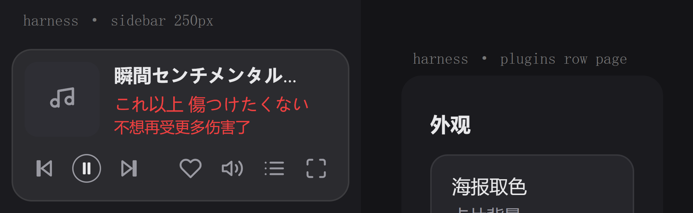
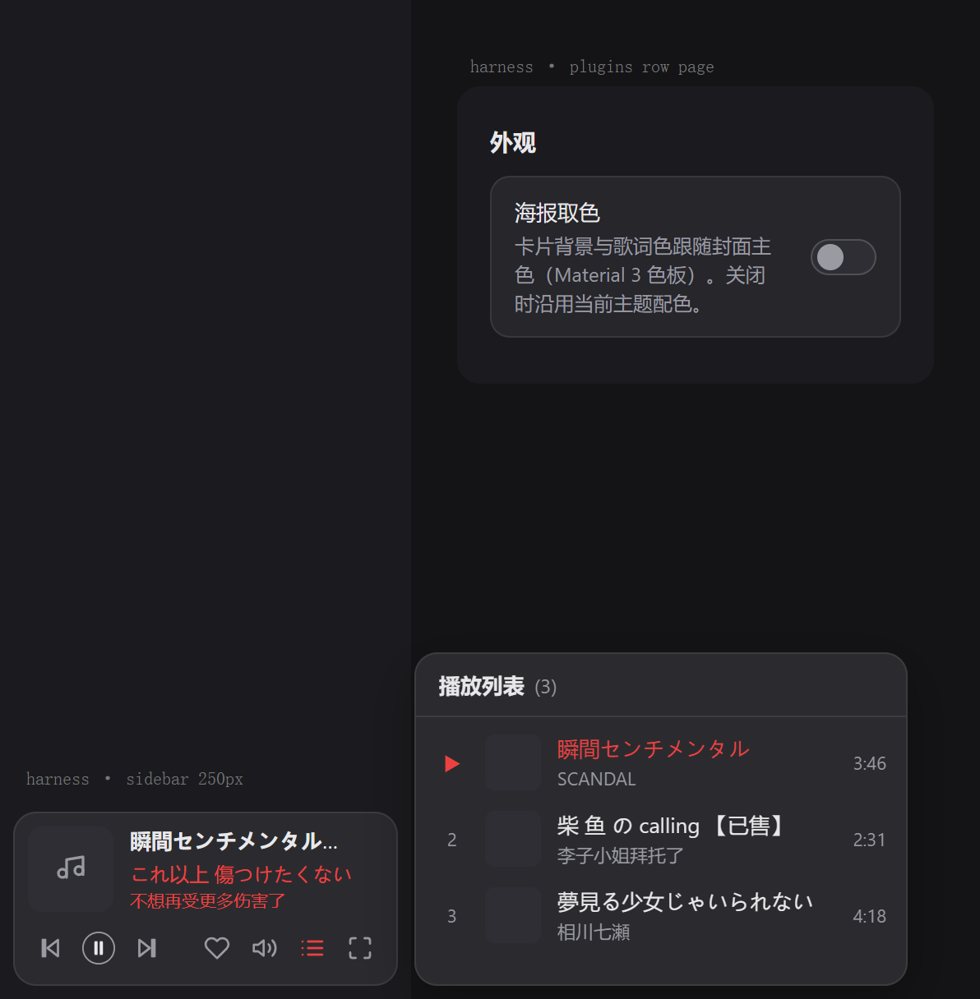
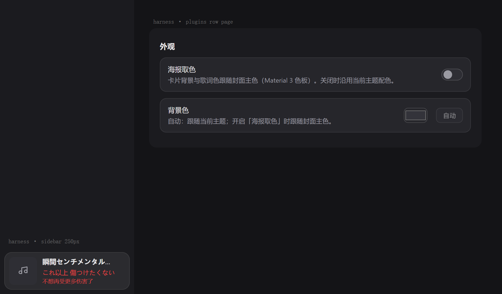
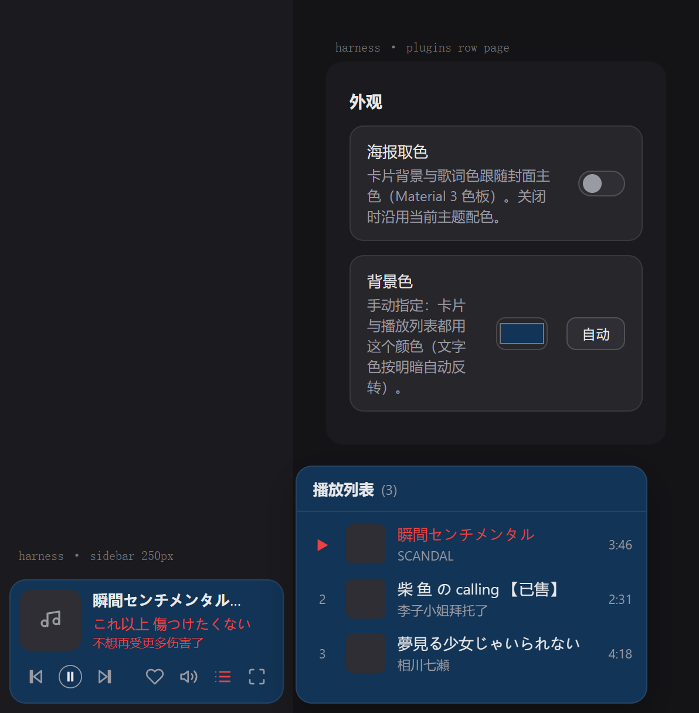

# 网易云音乐侧边栏卡片 · ncm-sidecard

把 [@wolfgenerals/ncm-player](https://github.com/WolfGenerals/ncm-player)（DSH 里的网易云音乐浮窗）**关闭后的形态**
搬进侧边栏：歌名 / 歌手 / 双语歌词 / 播放控制 / 收藏 / 音量 / 播放列表，可选按封面取色的 Material 3 配色。

- 播放器点 `×` 关闭 → 侧边栏底部出现控制卡片；点卡片上的 `⤢` 或封面 → 播放器窗口重新打开。
- 播放器点 `-` 最小化 → 仍是 ncm 自己的迷你条（本插件不接管）。
- 卡片显示期间会隐藏 ncm 的悬浮音符按钮，避免同一个入口出现两份。
- 侧边栏折叠成窄栏时不显示卡片，此时可用 ncm 自带的音符按钮。

| 卡片（收起 / 悬浮展开） | 播放列表 | 插件配置页 |
|---|---|---|
|  |  |  |

手动指定背景色后（卡片与列表同色，文字自动反转）：



> 截图由插件真实代码在离线渲染台中渲染（伪造播放器状态），不含个人主题/壁纸。

## 功能

- **卡片**：封面、歌名、歌手、双语歌词（有翻译才显示第二行）、悬浮出现的功能区。
- **功能区**（两组）：上一首 / 播放·暂停 / 下一首 ‖ 收藏 / 音量 / 播放列表 / 打开播放器。
- **播放列表**：右侧弹出，约窗口 1/3 高，点任意一首切歌；再点列表图标、点 DSH 其它任意区域或按 Esc 收起。
- **海报取色**（可选）：取封面主色，按 Material 3 色调层级生成容器色 / 描边 / 强调色。
- **背景色**（可选）：手动指定卡片颜色，卡片与弹窗共用同一材质色，文字按明暗自动反转。
- **配色一致性**：卡片与所有弹窗读同一个 `--nsc-material`，并对元素施加内联 `!important`，皮肤改不动。
- **首帧稳定**：底色采到错误的瞬态值（换肤/加载中）会自动重测纠正；配置与调色板本地缓存，重开即正确。

## 依赖

| 依赖 | 说明 |
|---|---|
| DSH 桌面版 | 需要具备 `sidebar.footer.action`（侧边栏底部槽位）与 `plugins.row.config`（插件行配置页）两个客户端槽位；在本仓库验证时使用 0.2.2-rc 系列 |
| [`@wolfgenerals/ncm-player`](https://github.com/WolfGenerals/ncm-player) | **必须已安装并启用**，版本 **1.2.0**（插件按它的内部结构适配，见「兼容性」） |
| `@deepseek-ai/schemastery` `~3.19.0` | host 半边声明配置用的 schema，已写在 `dependencies`；**必须在插件目录内 `pnpm install`**（见下） |

> ⚠️ DSH 的宿主是从插件的**真实路径**解析依赖的。用 `link:` 安装时插件目录里必须有 `node_modules`，
> 否则会报 `Cannot find package '@deepseek-ai/schemastery'`，该行「组件启用失败」。

## 安装

### 方式一：克隆 + 本地路径（推荐）

```bash
git clone git@github.com:Mny-Akum/DSH_Plugin.git
cd DSH_Plugin/ncm-sidecard
pnpm install                      # 安装 @deepseek-ai/schemastery 到插件目录
dsh plugin add link:/绝对路径/DSH_Plugin/ncm-sidecard
```

`dsh plugin add` 也可以直接给绝对路径：`dsh plugin add /绝对路径/DSH_Plugin/ncm-sidecard`。

### 方式二：pnpm 的 git 子目录选择器

```bash
dsh plugin add "github:Mny-Akum/DSH_Plugin#path:/ncm-sidecard"
```

取决于你的 pnpm 版本是否支持 `#path:` 选择器；不支持时请用方式一。

### 安装后

1. 确保 `@wolfgenerals/ncm-player` 也已启用；
2. **彻底退出 DSH 再启动**（关窗口不算，需结束进程）——host 半边的路由与配置项才会加载；
3. 页面加载后，把播放器窗口点 `×` 关闭，侧边栏底部就会出现卡片。

## 配置

侧边栏 **Plugins → 「网易云音乐侧边栏卡片」→ Configure（配置）→ 外观**：

| 选项 | 说明 |
|---|---|
| **海报取色** | 卡片背景与歌词色跟随封面主色（Material 3 色板：surfaceContainer / outline / primary 三档色调，深浅主题自动选档） |
| **背景色** | 默认「自动」（跟随主题，或海报取色开启时跟随封面）；也可手动选色，点「自动」恢复 |

两项都写在该行的 Config 里（`ncm-sidecard`，volatile），改完**立即生效**，无需重启。

## 工作原理

ncm-player 没有对外 API，全部状态都在它的 `NcmPlayer` 组件内部。本插件在客户端找到该组件的 React fiber，
按 **1.2.0 的 hook 布局**读取并驱动它自己的状态（队列、当前曲目、播放模式、音量、收藏…），因此：

- 播放仍完全由 ncm-player 负责（同一个 `<audio>`、同一份队列与持久化），两边始终同步；
- 每次使用前都会校验结构指纹（hook 数量 + 关键槽位类型）；**ncm-player 升级导致结构变化时卡片自动不显示**，
  原播放器功能不受影响，不会误操作。

封面取色需要读像素，跨域图片会污染 canvas，所以由 host 半边提供同源代理：

```
GET /ncm-sidecard/cover?url=<封面>
```

- 仅允许 `*.music.126.net` / `*.126.net` / `*.netease.com`，其它主机与 `file:` 一律 400；
- 向 CDN 追加 `param=64y64` 取缩略图（约 14KB），内存缓存 6 小时。

### 兼容性

| ncm-player | 状态 |
|---|---|
| 1.2.0 | 已验证 |
| 其它版本 | 卡片自动隐藏（结构指纹不匹配），ncm 自身功能正常 |

## 排查

| 现象 | 处理 |
|---|---|
| 卡片不出现 | ① `@wolfgenerals/ncm-player` 是否启用；② 播放器是否已 `×` 关闭；③ 侧边栏是否展开（窄栏不显示卡片）；④ 控制台有无 `[dsh-plugin-ncm-sidecard]` 报错 |
| 组件启用失败 / `Cannot find package '@deepseek-ai/schemastery'` | 在插件目录执行 `pnpm install` 后重启 DSH |
| 包不可用 · `Unexpected token '"', "name" ... is not valid JSON` | `package.json` 被写入了 UTF-8 BOM，用无 BOM 方式保存（本仓库内的文件已确保无 BOM） |
| 想要看真实绘制的颜色 | DevTools 控制台执行 `__nscColors()`，返回 `{ material, card, list, volume }` |
| 换肤后颜色没跟上 | 卡片会在 120/400/1200/2500ms 重测，并监听 `<html>`/`<body>` 属性变化；若仍不对可在控制台执行 `__nscColors()` 反馈 |

## 给 DSH 的安装提示词

把下面这段直接粘给 DSH 的 Agent，它会按步骤装好并验证：

```text
请帮我把 GitHub 仓库 git@github.com:Mny-Akum/DSH_Plugin.git 里的 ncm-sidecard 插件安装到当前 profile：

1. 克隆仓库到本地任意目录（记作 <repo>）。
2. 在 <repo>/ncm-sidecard 目录执行 pnpm install（host 半边需要 @deepseek-ai/schemastery 才能加载）。
3. 执行 dsh plugin add link:<repo>/ncm-sidecard，并确认该 bundle 已启用。
4. 确认 @wolfgenerals/ncm-player 已安装并启用（本插件依赖它，且按 1.2.0 的内部结构适配）。
5. 提示我彻底退出并重启 DSH。
6. 重启后帮我验证：请求 /ncm-sidecard/cover?url=<任一网易封面> 返回 200；侧边栏把播放器关闭后能看到卡片。
7. 告诉我配置入口：Plugins → 网易云音乐侧边栏卡片 → Configure → 外观（海报取色 / 背景色）。
```

## 目录

```
ncm-sidecard/
├── index.js           # host 半边：封面代理路由 + Config 声明
├── client.js          # 浏览器半边：卡片 UI、ncm-player 桥接、取色
├── package.json
├── cordis.patch.yml   # bundle patch（行 id：ncm-sidecard）
├── locale/            # 插件列表里的名称与描述
├── icon.svg
├── pnpm-lock.yaml
└── docs/screenshots/
```

## License

MIT
